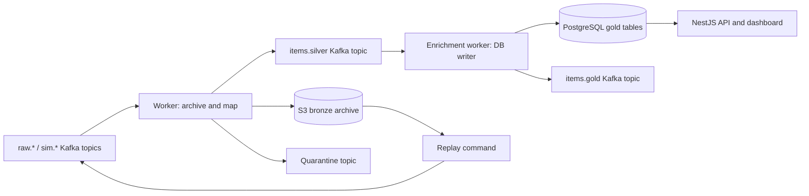

# Nexus

Nexus collects OSINT observations from Kafka, archives the original source records in S3, and makes normalized items queryable through PostgreSQL and a NestJS API.

## Current data flow



The worker writes exact raw Kafka bytes and transport metadata to a gzip NDJSON object in S3 before parsing. It then maps supported source formats into a versioned silver observation. It commits a raw offset only after the archive and silver publication succeed, or after the archive and quarantine publication succeed for invalid input.

The enrichment worker currently performs **no model enrichment**. It consumes `items.silver` and writes items, dimensions, media, engagement observations, and receipts in one PostgreSQL transaction. After that transaction it publishes the committed item as a `gold.v1` message to `items.gold` (keyed by item ID, republished on duplicates), and only then commits the silver offset. Each engagement measurement has its own row and event identity, so one post can have many observations, including at the same timestamp.

Kafka Connect is retired. The worker owns bronze archival; existing Avro archives remain replayable. The old database job and archive tables are retained for compatibility.

## Local development

Requirements: Node.js 22 or newer, npm 11, and Docker Compose for local infrastructure. From the repository root:

```powershell
npm ci
npm run local
```

`npm run local` builds and starts PostgreSQL, Kafka, LocalStack S3, the API, worker, and enrichment worker. The API listens on port 3000. For host-side watch mode, use `npm run infra:up`, `npm run db:prepare`, `npm run setup`, then `npm run dev:services`.

Useful commands:

| Command | Purpose |
| --- | --- |
| `npm run check` | Build, typecheck, verify migrations, and run tests |
| `npm run topics:setup` | Create source, silver, and quarantine topics |
| `npm run demo:publish` | Publish a demo source observation |
| `npm run replay -- <archive.jsonl.gz> <raw-topic>` | Replay original bytes and coordinates from a new S3 archive object |
| `npm run replay -- <archive.avro> <raw-topic>` | Replay an existing legacy Avro archive |
| `npm run local:down` | Stop local services while preserving database and Kafka volumes |

`S3_BUCKET`, `S3_REGION`, and optional `S3_ENDPOINT` configure the worker archive. `KAFKA_SILVER_TOPIC` defaults to `items.silver`; `KAFKA_SILVER_GROUP_ID` defaults to `nexus-silver-writer-v1`; `KAFKA_GOLD_TOPIC` defaults to `items.gold`. Reality 0 or 1 is assigned from the raw or simulation topic, never from a collector payload.

See [Getting Started](docs/GETTING_STARTED.md), the [database guide](docs/database/README.md), and the [API reference](docs/api-reference.html).
