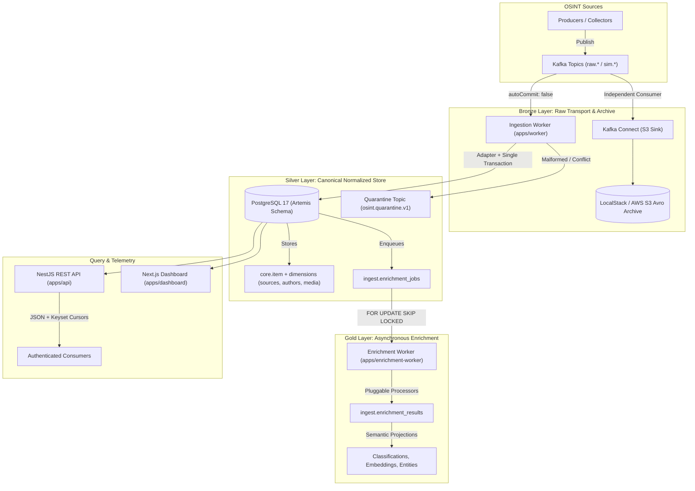

# Nexus — Developer Onboarding & Architecture Guide

Welcome to **Nexus**! This guide gives you the foundational mental model, architecture walkthrough, and essential commands you need to be productive within minutes.

---

## 1. Nexus in 30 Seconds

Nexus is a high-throughput, multi-platform **OSINT (Open-Source Intelligence)** data platform. It ingests real-time feeds from social media and news sources (Telegram, X, Reddit, etc.), transactionally deduplicates and normalizes them into a relational schema, enriches them asynchronously (NLP classification, sentiment, embeddings), and serves them via an authenticated NestJS query API and Next.js telemetry dashboard.

---

## 2. Medallion Architecture & Data Flow

Nexus structures data into three distinct Medallion layers:



### The Three Layers
1. **Bronze Layer (Raw Archive)**:
   - Kafka topics (`raw.<platform>.v1`, `sim.<platform>.v1`) receive incoming platform payloads.
   - Kafka Connect independently streams raw message bytes to versioned S3 Avro files.
   - `ingest.deliveries` records exact transport coordinates (`stream_id`, `topic`, `partition`, `offset_value`).
2. **Silver Layer (Canonical Relational Model)**:
   - `apps/worker` validates payloads with versioned adapters (`telegram.v1`, `provisional.v1`).
   - Transactionally updates `core.item`, `core.source`, `core.author`, `core.item_media`, and `core.engagement_snapshot`.
   - Protects against duplicate deliveries via `ingest.processing_receipts`.
3. **Gold Layer (Enrichment & Analytics)**:
   - `apps/enrichment-worker` polls pending tasks from `ingest.enrichment_jobs` using lease tokens (`FOR UPDATE SKIP LOCKED`).
   - Executes modular processors (diagnostics, sentiment, LLM summarization, dense vector embeddings).
   - Writes enriched results to `ingest.enrichment_results`.

---

## 3. Monorepo Map

```text
nexus/
├── apps/
│   ├── api/                  # NestJS REST API: 27 routes across 10 modules (Express platform)
│   ├── worker/               # NestJS Kafka ingestion worker: multi-platform consumers & adapters
│   ├── enrichment-worker/    # NestJS enrichment worker: atomic job leasing & pluggable processors
│   └── dashboard/            # Next.js 15 operational dashboard & live telemetry UI
├── packages/
│   ├── contracts/            # Zod schemas, normalization, canonical hashing, platform registry
│   ├── database/             # Drizzle ORM models, migrations, transactional ingest, atomic job queue
│   └── kafka/                # KafkaJS client wrapper, admin utilities, SASL/TLS options
├── docs/                     # Central documentation, ERDs, API reference, guides
├── infra/                    # Docker Compose configs (Kafka, PostgreSQL 17, LocalStack S3, Connect)
└── scripts/                  # Operations CLI: topic setup, migrations, demo publisher, Avro replay
```

---

## 4. 5-Minute Local Setup

### Prerequisites
- **Node.js** >= 22 (Node 24 recommended) & **npm** 11
- **Docker** with Compose v2

### Quick Start
```powershell
# 1. Clone & install dependencies
npm ci

# 2. Initialize environment configuration
Copy-Item .env.example .env

# 3. Start local infrastructure and watch dev services
npm run local:dev
```

`npm run local:dev` automatically:
1. Boots backing Docker containers: PostgreSQL (with PostGIS, pgvector, pg_trgm), Kafka, LocalStack S3, and Kafka Connect.
2. Checks and applies database migrations (`db:prepare`).
3. Initializes Kafka topics for all 10 supported platforms (`topics:setup`).
4. Registers the S3 sink connector with Kafka Connect (`archive:register`).
5. Concurrently launches `@nexus/api`, `@nexus/worker`, and `@nexus/enrichment-worker` with live file reloading (`tsx watch`).

### Access Points
- **API**: `http://localhost:3000` (Bearer Token: `local-development-token-change-me`)
- **Dashboard**: `http://localhost:3001` (Run with `npm run ui`)
- **Local S3 (LocalStack)**: `http://localhost:4566` (Bucket: `nexus-raw`)
- **Kafka Connect REST API**: `http://localhost:8083`

---

## 5. Daily Development Cheat Sheet

| Task | Command | Notes |
| --- | --- | --- |
| **Run all services (dev watch)** | `npm run dev:services` | Runs API, Ingestion Worker, and Enrichment Worker concurrently. |
| **Run only API** | `npm run dev:api` | Hot-reloads on edits in `apps/api/src/`. |
| **Run only Ingestion Worker** | `npm run dev:worker` | Hot-reloads on edits in `apps/worker/src/`. |
| **Run only Enrichment Worker** | `npm run dev:enrichment-worker` | Hot-reloads on edits in `apps/enrichment-worker/src/`. |
| **Run Dashboard UI** | `npm run ui` | Starts Next.js dev server on port 3001. |
| **Full validation check** | `npm run check` | **Run on every change**: builds, typechecks, tests, and verifies DB models. |
| **Fast embedded tests** | `npm test` | Runs Vitest against fast in-memory `@electric-sql/pglite`. |
| **Integration tests** | `npm run test:integration` | Runs real PostgreSQL tests (requires `$env:INTEGRATION_DATABASE_URL`). |
| **Publish demo event** | `npm run demo:publish` | Emits a sample Telegram post to Kafka to test the ingestion pipeline. |
| **Replay raw archive** | `npm run replay -- ./archive.avro raw.telegram.v1` | Recovers and replays raw Avro records into Kafka. |
| **Apply DB migrations** | `npm run db:migrate` | Applies pending Drizzle migrations. |
| **Generate DB migration** | `npm run db:generate -- --name my_change` | Generates a new migration from Drizzle schema modifications. |

---

## 6. The Journey of an OSINT Message

Here is what happens when a message is processed:

1. **Ingress**: A collector publishes raw message JSON to a Kafka topic (e.g. `raw.telegram.v1`).
2. **Platform Ingestion**: `apps/worker` receives the message (`autoCommit: false`).
3. **Payload Adaptation**: An adapter (e.g., `telegram.v1`) validates the schema with Zod and extracts normalized item fields (`title`, `content_text`, `lang`, `urls`, `media`).
4. **Transactional Persistence (`ingest()`)**:
   - Computes canonical SHA-256 hash of payload.
   - Verifies transport delivery coordinates (`stream_id`, `topic`, `partition`, `offset_value`).
   - Checks `ingest.processing_receipts`. If already processed, commits offset and exits (idempotent duplicate protection).
   - Upserts `core.source` and `core.author`.
   - Acquires advisory lock and inserts/updates `core.item`.
   - Inserts media attachments into `core.item_media` and snapshot metrics into `core.engagement_snapshot`.
   - Inserts required task records into `ingest.enrichment_jobs`.
   - Inserts a new processing receipt and commits the PostgreSQL transaction.
5. **Kafka Acknowledgment**: Only after the DB transaction commits does the worker commit `offset + 1` to Kafka. If the payload was corrupt, it is sent to `osint.quarantine.v1` before offset commit.
6. **Asynchronous Enrichment**:
   - `apps/enrichment-worker` claims the job from `ingest.enrichment_jobs` using `FOR UPDATE SKIP LOCKED` and an expiring lease token.
   - Executes registered processors (e.g. LLM summary, sentiment, embeddings).
   - Writes results to `ingest.enrichment_results`.
7. **Query**: An analyst or dashboard queries `GET /v1/items/:id` to retrieve the fully assembled item with all joined relations and enrichment data.

---

## 7. Golden Rules & Gotchas to Avoid

- **Reality Scoping**:
  - Reality `0` = Real-world production data.
  - Reality `1` = Simulation / war-game exercises.
  - **The mapping is strictly worker-assigned** based on the topic (`raw.*` -> `0`, `sim.*` -> `1`). Ingestion payloads must **never** supply a `realityId` (payloads containing `realityId` are rejected to quarantine).
- **Idempotency & Replay**:
  - `eventId` is globally unique and immutable. Never alter or regenerate an `eventId` during retry or replay.
  - If identical bytes arrive again, the worker detects the receipt and skips reprocessing without corrupting data.
- **Offset Commits**:
  - Never acknowledge a Kafka message on transient infrastructure errors (DB down, network drop). Let the worker crash so supervisor/Docker restarts it and Kafka retries.
- **Pagination**:
  - Never use `OFFSET ... LIMIT`. Always use deterministic keyset cursor pagination on `(published_at DESC, item_id DESC)`.
- **NodeNext ESM Imports**:
  - Always append `.js` to relative TypeScript imports (e.g., `import { foo } from './foo.js'`).
- **Build Before Testing**:
  - API and worker unit tests reflect over compiled metadata (`dist/`). Run `npm run build` before executing tests when touching decorators or DI providers.

---

## 8. Deep-Dive Documentation Index

- 🗄️ **Database Schema & Migrations**: [docs/database/README.md](database/README.md)
- 📊 **Database ERD Diagram (19 Tables)**: [docs/database/erd.md](database/erd.md)
- 🌐 **Interactive API Specification (27 Routes)**: [docs/api-reference.html](api-reference.html)
- 🤖 **Enrichment Worker Architecture & Adding Processors**: [docs/enrichment-foundation.md](enrichment-foundation.md)
- 📋 **Coding Standards & Rules**: [AGENTS.md](../AGENTS.md)
