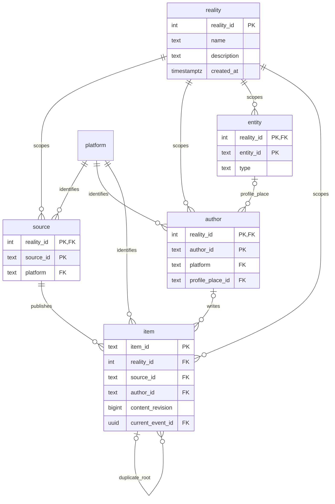
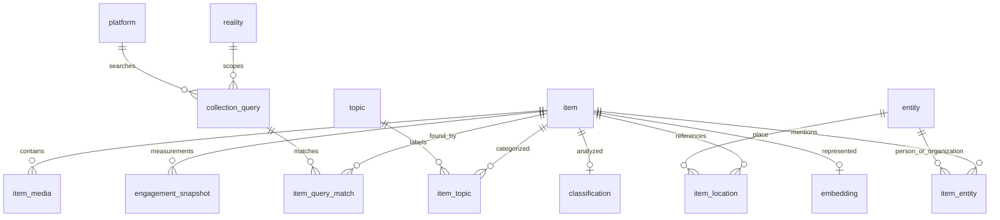
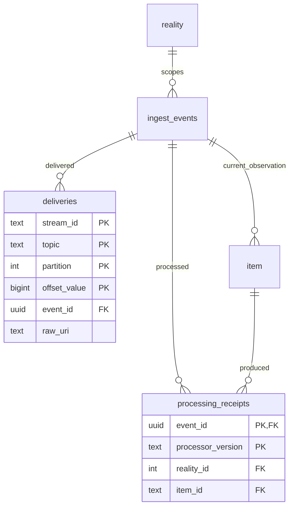

# Artemis database

The initial Artemis schema stores current OSINT items from multiple platforms,
keeps simulation metadata separate from reality 0, and leaves room for later
enrichment. It retains all 123 columns from the supplied Artemis HTML, with the
reviewed changes below. There are 19 application tables, one `core.item_ds` view,
and Drizzle's migration ledger in `drizzle.__drizzle_migrations`.

The worker and API use the Artemis schema. Kafka Connect remains the sole S3 writer.
See the [ingestion implementation](../plans/item-ingestion.md).

## ERD diagrams

The diagrams below show relationships and identity columns. Multiple PK markers
mean one composite key. All columns appear in the [full ERD](erd.md).







## Final design decisions

| Decision | Reason |
| --- | --- |
| One current item row; observations retained through event/delivery provenance and S3 | Supports the query API without duplicating item rows for every scrape. SQL content-version history is not part of this phase. |
| `reality` registry; sources/authors/entities keyed within a reality | Simulation metadata cannot overwrite real profiles or places. Real world 0 and ten platforms are seeded; simulator runs must be registered. |
| Shared `platform` and `topic` registries; reality-scoped `collection_query` | Platform expansion needs a registry entry and adapter. Query/topic links refer to defined records. Subjects are distinct from Kafka topics. |
| Composite item-source/author/event and relationship FKs | Enforces reality and platform consistency in the database. Replies/quotes may reference uncollected items, so those fields remain logical references. |
| Revision-tagged enrichment | A content edit requires a newer revision. Old results disappear from the current view; stale enrichment writes are rejected. Media-input changes must also advance the revision in the future writer. |
| Provider-aware engagement keys | Two providers measuring at the same time can both be preserved. The view picks by captured time descending, provider ascending and exposes the provider. |
| Nullable item URL, source handle/URL and source arena | Unknown metadata stays unknown. Archive URI fields are also nullable until Connect output is resolved. Other original nullability/defaults remain. |
| Cursor indexes include `(reality_id,published_at DESC,item_id DESC)` | Equal publication times still have a deterministic order. Platform/source/author/language filters have matching indexes. |
| Retain pgvector/PostGIS types; defer HNSW indexes | Embedding computation and filtered approximate-search tuning come later. No invented vectors or scores. |
| No automatic 14-day expiry | Retention must be coordinated with replay receipts, duplicate roots and raw archives first. |

`core.item_ds` joins dimensions within the item's reality, uses only current
enrichment revisions, and returns empty topic/domain arrays when there are none.
It keeps a selected place's unknown country NULL instead of substituting the
publisher's country. Source-country fallback applies only when no place is selected.
The view includes all realities: API list, detail, counts, search and relationship
queries must explicitly scope reality, defaulting to 0.

Database triggers enforce immutable identities, entity-type links, query-platform
matches, monotonic item revision/last-seen time, current enrichment revisions, and
duplicate links pointing directly to roots. Child records cascade with their item;
referenced dimensions, events and receipts restrict deletion. Content-duplicate
detection itself remains a later writer feature; blank/media-only posts must not
be grouped by an empty-text hash.

## ORM and migrations

The application uses Drizzle ORM with the existing node-postgres pool. Ordinary
writes, reads, relationships and upserts use typed models. PostgreSQL-specific
locks, triggers, PostGIS and catalog inspection remain explicit SQL.

`schema/` is organized by domain:

```text
schema/
  base.ts                 schemas, enums and custom types
  registry/               reality, platform, topic, collection-query
  identity/               source, author, entity
  items/                  item, media, engagement, query matches
  enrichment/             classification, embedding, topics, locations, entities
  ingestion/              immutable events, transport deliveries, receipts
  index.ts                stable public exports
```

Drizzle supplies [migration generation](https://orm.drizzle.team/docs/drizzle-kit-generate),
[execution](https://orm.drizzle.team/docs/drizzle-kit-migrate) and
[history consistency checks](https://orm.drizzle.team/docs/drizzle-kit-check).
`migrations.ts` is a small wrapper around the built-in migrator: it serializes
simultaneous deploys with an advisory lock and verifies deployed checksums/order.
It does not implement SQL execution, journal parsing or a second migration ledger.
The old legacy schema file and custom migration runner have been retired.

| Command | What it verifies or changes |
| --- | --- |
| `npm run db:generate -- --name describe_change` | Generates SQL by comparing typed models with the previous Drizzle model snapshot. Review the SQL. |
| `npm run db:generate -- --custom --name describe_change` | Creates a migration for triggers, views, seeds or data changes. |
| `npm run db:check` | Checks migration history and runs generation in a temporary directory; fails if model changes lack a migration. Included in `npm run check`. |
| `npm run db:migrate` | Applies pending migrations using Drizzle and checks the deployed history. Does not automatically repair drift. |
| `npm run db:verify` | Compares live PostgreSQL with a fresh reference database built from the same migrations. Target schema is read-only. |
| `npm run db:prepare` | Runs model checks, migration and live comparison for local development. Included in `local:dev`. |

`db:verify` compares tables, columns/types/defaults, constraints, indexes, enums,
views, triggers, functions, extension versions and row-security flags in managed
schemas. It catches a manually dropped index or disabled trigger even when the
migration ledger is unchanged. It does not compare application data, role grants,
policy definitions or unmanaged schemas. Row-security policies are not part of the
current schema. Use the same PostgreSQL/extension versions for both databases.

By default, verification creates and removes a randomly named reference database
on the same server, so the checking role needs CREATEDB. To keep that permission
out of production, supply `SCHEMA_REFERENCE_DATABASE_URL` pointing to an already
migrated, disposable reference database; it is read-only in this mode.

CI runs `npm run check`, starts real PostgreSQL with extensions, applies migrations,
runs `db:verify`, then the real concurrency tests. See
[the workflow](../../.github/workflows/verify.yml). This verifies pull requests;
it does not deploy production. A deployment should run migration then verification
before starting the new services.

Local Compose also enables live verification in its setup service before the worker
and API start. Other deployments can enable `VERIFY_DATABASE_SCHEMA=true` and,
when needed, provide `SCHEMA_REFERENCE_DATABASE_URL` to the setup service.

Never edit an applied migration. Add another migration and synchronize the
`src/schema.sql` snapshot. Tests compare its actual PostgreSQL catalog with the
migration chain. Drizzle snapshots describe ORM models; triggers and views are
reviewed SQL. Do not use `drizzle-kit push` as a deployment shortcut.

The initial generated SQL required corrections for `geography(Point,4326)` and
schema-qualified `core.time_source`; review these declarations in future generated
migrations. SQL statement breakpoints let both Drizzle's pg and PGlite migrators
execute function bodies and extension statements. Migration files use LF endings
so their checksums agree between Windows and CI.

Migration 0001 explicitly drops the old public document tables, as approved for
this development cutover. It does not import old rows. Migration 0002 permits
pending archive links and allows each delivery's link to be filled once.
Deploy this cutover with old workers stopped; their old payload format is not an
input adapter for this release.

## PostgreSQL and archive boundaries

Local Compose builds `infra/postgres/Dockerfile`: PostgreSQL 17 on Debian Trixie
with PostGIS, pgvector and pg_trgm. Keep the database image's OS/collation version
compatible with existing volumes. Cloud PostgreSQL must provide these extensions.

Kafka Connect archives raw bytes independently. The worker saves stream/topic/
partition/offset in `ingest.deliveries`; both item and delivery `raw_uri` remain
NULL until the exact S3 location has been resolved. No worker S3 client or upload
exists. An archive resolver is future work; do not construct an assumed S3 filename
from the offset because Connect writes asynchronous batches.

Bigint values are represented by JS `bigint` internally and decimal strings in
API responses. Spatial writes accept EWKT; use PostGIS projection functions for
coordinates. API endpoints require explicit reality scoping, defaulting to 0.
Ingestion reality is assigned by the worker's source configuration, never by the
Kafka payload: real sources use 0 and simulation subscriptions select a registered
positive ID. That assignment is propagated to items, dimensions, events and receipts.

## Verification

Embedded tests use PGlite with actual PostGIS, vector and pg_trgm extensions.
They cover all 123 original HTML column names, SQL snapshot equivalence, relational
rules, ingestion/replay, partial metadata, stale enrichment, migration rollback,
API filtering and acknowledgements. Real tests create and remove isolated databases
rather than trying to isolate the named `core` and `ingest` schemas via search_path.

Time partitioning and HNSW indexes remain deferred until workload measurements
justify them. This schema keeps current item state and S3 observation history;
it is not a full relational history of every content revision.
