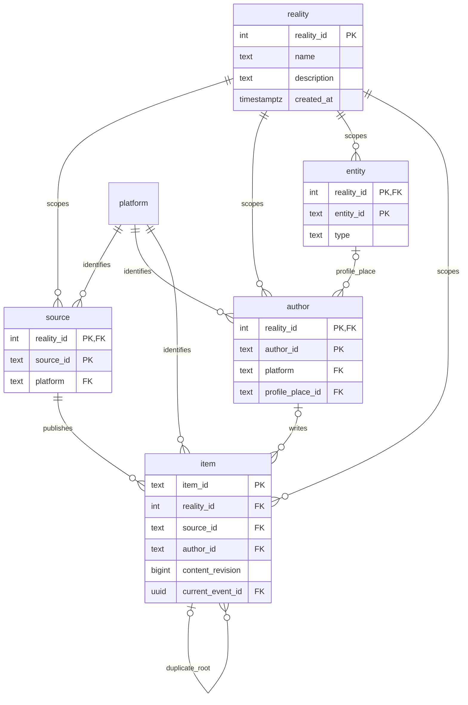
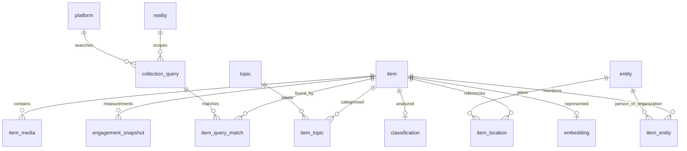
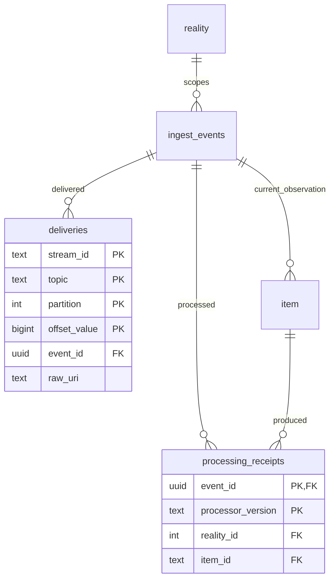

# Artemis database

The initial Artemis schema stores current OSINT items from multiple platforms,
keeps simulation metadata separate from reality 0, and leaves room for later
enrichment. It retains all 123 columns from the supplied Artemis HTML, with the
reviewed changes below. There are 19 application tables, one `core.item_ds` view,
and the migration ledger in `public.schema_migrations`.

The schema and typed Drizzle models are implemented. The current worker/API still
use the legacy public tables. Their cutover is the [next phase](../plans/item-ingestion.md).

## ERD diagrams

The diagrams below show relationships and identity columns. Multiple PK markers
mean one composite key. All columns appear in the [full ERD](erd.md).







## Final design decisions

| Decision | Reason |
| --- | --- |
| One current item row; observations retained through event/delivery provenance and S3 | Supports the query API without duplicating item rows for every scrape. SQL content-version history is not part of this phase. |
| `reality` registry; sources/authors/entities keyed within a reality | Simulation metadata cannot overwrite real profiles or places. Real world 0 and ten platforms are seeded; simulator runs must be registered. |
| Shared `platform` and `topic` registries; reality-scoped `collection_query` | Platform expansion needs a registry entry and adapter. Query/topic links refer to defined records. Subjects are distinct from Kafka topics. |
| Composite item-source/author/event and relationship FKs | Enforces reality and platform consistency in the database. Replies/quotes may reference uncollected items, so those fields remain logical references. |
| Revision-tagged enrichment | A content edit requires a newer revision. Old results disappear from the current view; stale enrichment writes are rejected. Media-input changes must also advance the revision in the future writer. |
| Provider-aware engagement keys | Two providers measuring at the same time can both be preserved. The view picks by captured time descending, provider ascending and exposes the provider. |
| Nullable item URL, source handle/URL and source arena | Unknown metadata stays unknown. Other original nullability/defaults remain. |
| Cursor indexes include `(reality_id,published_at DESC,item_id DESC)` | Equal publication times still have a deterministic order. Platform/source/author/language filters have matching indexes. |
| Retain pgvector/PostGIS types; defer HNSW indexes | Embedding computation and filtered approximate-search tuning come later. No invented vectors or scores. |
| No automatic 14-day expiry | Retention must be coordinated with replay receipts, duplicate roots and raw archives first. |

`core.item_ds` joins dimensions within the item's reality, uses only current
enrichment revisions, and returns empty topic/domain arrays when there are none.
It keeps a selected place's unknown country NULL instead of substituting the
publisher's country. Source-country fallback applies only when no place is selected.
The view includes all realities: API list, detail, counts, search and relationship
queries must explicitly scope reality, defaulting to 0.

Database triggers enforce immutable identities, entity-type links, query-platform
matches, monotonic item revision/last-seen time, current enrichment revisions, and
duplicate links pointing directly to roots. Child records cascade with their item;
referenced dimensions, events and receipts restrict deletion. Content-duplicate
detection itself remains a later writer feature; blank/media-only posts must not
be grouped by an empty-text hash.

## ORM and migrations

Drizzle ORM 0.45.4 uses the existing `pg` pool and typed table models in
`packages/database/src/schema/`. `createItemDatabase(pool)` returns the client.
Use explicit transactions, upserts and row locks in the future ingest repository.
Bigint fields use JavaScript `bigint`; API serializers must convert them to decimal
strings. Spatial writes accept PostGIS EWKT; use the view or PostGIS projection
functions for coordinates instead of treating returned EWKB as a JS object.

Drizzle was selected for its [pg/PGlite drivers](https://orm.drizzle.team/docs/connect-overview),
[explicit transactions](https://orm.drizzle.team/docs/transactions), and
[custom types](https://orm.drizzle.team/docs/custom-types). Prisma is also viable
and has an [extension mechanism](https://www.prisma.io/docs/orm/extensions);
the decision is repository fit, not an asserted performance advantage.

| File | Role |
| --- | --- |
| `packages/database/src/schema/*.ts` | Typed table, enum, constraint and index definitions. |
| `packages/database/drizzle/` | Reviewed Drizzle migrations and model snapshots. |
| `packages/database/src/schema.sql` | Declarative Artemis snapshot; initially identical to the first Artemis migration. |
| `packages/database/src/schema-rules.sql`, `item-view.sql` | Readable sources for advanced initial triggers/view, included in the initial migration. |
| `packages/database/src/migrations/0001_legacy.sql` | Frozen original schema for transition and existing tests. |
| `packages/database/src/migrations.ts` | Advisory lock, extension preflight, SHA-256 migration checksums and atomic application. |

Run all commands from the repository root:

```sh
npm run db:generate -- --name describe_change
npm run db:migrate
npm run check
```

The generator reads compiled models and creates SQL; review it before applying.
In Drizzle Kit 0.31.11, review custom geography declarations and schema-qualified
enum names carefully. The initial migration corrects the generated spelling to
`geography(Point, 4326)` and `core.time_source`. Embedded tests execute the resulting
SQL with the real extension types, so invalid generated declarations fail validation.
For triggers, extension setup or data changes, use:

```sh
npm run db:generate -- --custom --name describe_change
```

The migration runner reads the Drizzle journal after legacy migration 1. It does
not use a second Drizzle migration ledger. Keep journal order contiguous and
never change an applied migration: the runner rejects checksum mismatches. The
older checksum-free version-1 ledger is adopted once. Keep `schema.sql` synchronized
with the resulting schema when adding later migrations. Edit the initial helper
SQL through a new migration after deployment, not by rewriting history.

Do not use `drizzle-kit push` or a separate `drizzle-kit migrate` against this
database. Deploy schema changes through `npm run db:migrate` so locking and the
single ledger remain authoritative. Migration does not delete or import legacy
data; worker/API cutover and old-table removal will be separate reviewed steps.

## PostgreSQL extensions

The stock local PostgreSQL image does not provide all required extensions.
An extension-enabled PostgreSQL 17 image is defined in `infra/postgres/Dockerfile`.
Build it and select it through the existing image override:

```powershell
docker build -t nexus-postgres:local infra/postgres
$env:POSTGRES_IMAGE = 'nexus-postgres:local'
npm run infra:up
npm run db:migrate
```

Keep that image override for subsequent Compose runs. Existing configuration files
do not need edits. The migration fails with the missing extension names if PostGIS,
pgvector or pg_trgm is unavailable. Cloud deployments must provide those extensions
and grant the migration role permission to enable them.

## Verification and limits

The new tests use PGlite 0.4.6 with its matching PostGIS 0.0.8 extension, plus its
bundled pgvector and pg_trgm. They execute the actual schema and triggers, without
substituting spatial or vector types. Existing worker/API tests continue to load
the frozen legacy schema during the transition.

Initial verification: `npm run check` passed all type checks, builds and 48 tests
(including 15 new schema/migration tests). These cover the HTML's 123 original
columns, reality isolation, entity/query links, duplicate roots, stale enrichment,
spatial/vector storage, and migration rollback/checksums. Drizzle generation
reported no pending model changes, and all ERD table columns matched its snapshot.

Docker was unavailable during initial development. Embedded tests cannot establish
production throughput or concurrent-session behavior. The real PostgreSQL suite
and extension-image build must also run before deployment. A future full-schema
integration test must use a disposable database: hard-coded `core`/`ingest` names
cannot be isolated merely by changing `search_path`.

Time partitioning is deferred. PostgreSQL requires partition-key columns in
partitioned unique constraints, so partitioning by time would need an identity and
retention design rather than a quick index change. See the official
[partitioning](https://www.postgresql.org/docs/17/ddl-partitioning.html) and
[constraint](https://www.postgresql.org/docs/17/ddl-constraints.html) documentation.
