# Full Artemis ERD

All 19 application tables and their columns. Multiple PK markers indicate a composite primary key. The first 16 tables are in `core`; the final three are in `ingest`. For constraints, indexes, the query view and migration instructions, see the [database guide](README.md).

```mermaid
erDiagram
    reality {
        int reality_id PK "NOT NULL; Nonnegative ID. Seed 0 = Real world; explicitly register simulation runs."
        text name "NOT NULL; Readable reality or exercise name."
        text description "NULL allowed; Optional purpose or scenario description."
        timestamptz created_at "NOT NULL; DEFAULT now()."
    }
    platform {
        text platform PK "NOT NULL; Stable platform code. Seed the ten platforms listed in the HTML."
        text display_name "NOT NULL; Human-readable platform name."
    }
    source {
        text source_id PK "NOT NULL"
        text platform FK "NOT NULL; Platform registry FK replaces core.platform enum."
        text source_kind "NOT NULL"
        text handle_or_url "NULL allowed; Intentional change: NULL if only the native source identity is available."
        text display_name "NULL allowed"
        text arena "NULL allowed; Intentional change: NULL until authoritative registry metadata supplies IL, ARAB or INTL. Never guess."
        char home_country "NULL allowed; char(2)"
        text default_language "NULL allowed"
        bigint subscribers "NULL allowed"
        text tier "NULL allowed"
        text added_by "NULL allowed"
        text reason "NULL allowed"
        boolean active "NOT NULL; default true"
        timestamptz updated_at "NOT NULL; default now()"
        int reality_id PK,FK "NOT NULL; DEFAULT 0; FK to reality; scopes identity and mutable metadata."
        timestamptz metadata_observed_at "NULL allowed; When collector-provided source metadata was measured; guards late count/profile updates independently of updated_at."
    }
    author {
        text author_id PK "NOT NULL"
        text native_user_id "NULL allowed"
        text handle "NULL allowed"
        text display_name "NULL allowed"
        text bio "NULL allowed"
        text profile_location "NULL allowed"
        text profile_place_id FK "NULL allowed; Optional composite FK (reality_id, profile_place_id) to entity; LOC-only validation."
        bigint followers "NULL allowed"
        bigint following "NULL allowed"
        bigint posts_count "NULL allowed"
        boolean verified "NULL allowed"
        text verified_type "NULL allowed"
        timestamptz account_created_at "NULL allowed"
        boolean is_automated "NULL allowed"
        real bot_score "NULL allowed"
        timestamptz profile_seen_at "NOT NULL"
        int reality_id PK,FK "NOT NULL; DEFAULT 0; FK to reality; scopes identity and mutable metadata."
        text platform FK "NOT NULL; Explicit platform FK; enables item-author platform consistency."
    }
    entity {
        text entity_id PK "NOT NULL"
        text type "NOT NULL"
        text canonical_name "NOT NULL"
        char country "NULL allowed; char(2)"
        text admin1 "NULL allowed"
        bigint geonames_id "NULL allowed"
        geography geom "NULL allowed; geography(Point, 4326)"
        int reality_id PK,FK "NOT NULL; DEFAULT 0; FK to reality; scopes identity and mutable metadata."
    }
    item {
        text item_id PK "NOT NULL"
        int reality_id FK "NOT NULL; default 0; DEFAULT 0; CHECK >= 0; FK to registered reality."
        text platform FK "NOT NULL; Platform registry FK replaces core.platform enum."
        text native_id "NOT NULL"
        text url "NULL allowed; Intentional change: NULL if no legitimate canonical link can be constructed."
        item_type item_type "NOT NULL"
        text schema_version "NOT NULL; default 'item.v1'"
        text source_id FK "NOT NULL; Composite FK (reality_id, source_id, platform) to source."
        text author_id FK "NULL allowed; Optional composite FK (reality_id, author_id, platform) to author."
        text author_name_raw "NULL allowed"
        timestamptz published_at "NOT NULL"
        time_source published_at_source "NOT NULL"
        timestamptz edited_at "NULL allowed"
        timestamptz collected_at "NOT NULL"
        text title "NULL allowed"
        text content_text "NOT NULL"
        text lang "NULL allowed"
        real lang_confidence "NULL allowed"
        text lang_platform "NULL allowed"
        text_array hashtags "NOT NULL; default '{}'"
        text_array mentions "NOT NULL; default '{}'"
        text_array links "NOT NULL; default '{}'"
        boolean is_sensitive "NULL allowed"
        text reply_to_item_id "NULL allowed"
        text conversation_id "NULL allowed"
        text quoted_item_id "NULL allowed"
        text shared_from_item_id "NULL allowed"
        text shared_from_source "NULL allowed"
        text content_hash "NOT NULL"
        bigint simhash "NULL allowed"
        text dup_of FK "NULL allowed; Composite FK (reality_id, dup_of) to item; no self-reference; same-reality root only."
        timestamptz deleted_at "NULL allowed"
        text collector "NOT NULL"
        text provider "NOT NULL"
        text raw_uri "NOT NULL"
        jsonb platform_extra "NOT NULL; default '{}'"
        tsvector tsv "NULL allowed; GENERATED STORED"
        timestamptz last_seen_at "NOT NULL; Latest observed collection time; never decreases; index/update metadata only."
        uuid current_event_id FK "NOT NULL; Composite FK with reality_id to ingest_events; identifies the observation selected for current content and raw_uri."
        bigint content_revision "NOT NULL; DEFAULT 1; positive. Increment when inputs used by enrichment materially change."
    }
    item_media {
        text item_id PK,FK "NOT NULL"
        smallint position PK "NOT NULL"
        text media_type "NOT NULL"
        text media_url "NULL allowed"
        text thumb_url "NULL allowed"
        real duration_s "NULL allowed"
        int width "NULL allowed"
        int height "NULL allowed"
        text alt_text "NULL allowed"
        text s3_uri "NULL allowed"
        text ocr_text "NULL allowed"
        text transcript "NULL allowed"
    }
    engagement_snapshot {
        text item_id PK,FK "NOT NULL"
        timestamptz captured_at PK "NOT NULL"
        bigint views "NULL allowed"
        bigint likes "NULL allowed"
        text likes_kind "NULL allowed"
        bigint reposts "NULL allowed"
        bigint replies "NULL allowed"
        bigint quotes "NULL allowed"
        bigint saves "NULL allowed"
        jsonb reactions "NULL allowed"
        text provider PK "NOT NULL; Provider that measured these counts; part of snapshot primary key."
    }
    topic {
        text topic_id PK "NOT NULL; Stable subject ID, shared taxonomy managed by configuration."
        text name "NOT NULL; For example: politics, economy, security."
        text description "NULL allowed; Definition used by classifiers."
        boolean active "NOT NULL; DEFAULT true. Disable rather than remove referenced definitions."
    }
    item_topic {
        text item_id PK,FK "NOT NULL"
        text topic_id PK,FK "NOT NULL; FK to topic registry."
        real score "NOT NULL"
        bigint content_revision "NOT NULL; Positive input revision. Current reads include only rows matching item.content_revision."
    }
    collection_query {
        int reality_id PK,FK "NOT NULL; Reality FK; part of composite primary key."
        text query_id PK "NOT NULL; Immutable versioned query ID within a reality."
        text platform FK "NOT NULL; Platform FK."
        text query_text "NOT NULL; Actual collector search expression; changing its meaning creates a new query_id."
        text description "NULL allowed; Readable purpose."
        boolean active "NOT NULL; DEFAULT true."
    }
    item_query_match {
        text item_id PK,FK "NOT NULL"
        text query_id PK,FK "NOT NULL; Composite FK (reality_id, query_id) to collection_query; query platform must match item."
        timestamptz matched_at "NOT NULL"
        int reality_id FK "NOT NULL; Composite item and dimension FKs prevent cross-reality links."
    }
    item_location {
        text item_id PK,FK "NOT NULL"
        text place_id PK,FK "NOT NULL"
        geo_kind geo_kind PK "NOT NULL"
        text surface_form "NULL allowed"
        real confidence "NULL allowed"
        bigint content_revision "NOT NULL; Positive input revision. Current reads include only rows matching item.content_revision."
        int reality_id FK "NOT NULL; Composite item and dimension FKs prevent cross-reality links."
    }
    item_entity {
        text item_id PK,FK "NOT NULL"
        text entity_id PK,FK "NOT NULL"
        text surface_form PK "NOT NULL"
        bigint content_revision "NOT NULL; Positive input revision. Current reads include only rows matching item.content_revision."
        int reality_id FK "NOT NULL; Composite item and dimension FKs prevent cross-reality links."
    }
    classification {
        text item_id PK,FK "NOT NULL"
        text model "NOT NULL"
        text prompt_version "NOT NULL"
        real relevance "NULL allowed"
        real misinfo_score "NULL allowed"
        text sentiment "NULL allowed"
        text summary_en "NULL allowed"
        timestamptz classified_at "NOT NULL"
        bigint content_revision "NOT NULL; Positive input revision. Current reads include only rows matching item.content_revision."
    }
    embedding {
        text item_id PK,FK "NOT NULL"
        text model "NOT NULL"
        vector content_vec "NOT NULL; vector(1024)"
        vector title_vec "NULL allowed; vector(1024)"
        timestamptz embedded_at "NOT NULL"
        bigint content_revision "NOT NULL; Positive input revision. Current reads include only rows matching item.content_revision."
    }
    ingest_events {
        uuid event_id PK "NOT NULL; Immutable incoming eventId; global primary key."
        text event_hash "NOT NULL; SHA-256 of immutable original event content, independent of normalizer version and S3 destination."
        text schema_version "NOT NULL; Input event contract version."
        int reality_id FK "NOT NULL; Validated reality FK; event reality is immutable."
        timestamptz observed_at "NOT NULL; Collection observation time."
        timestamptz ingested_at "NOT NULL; DEFAULT now()."
    }
    deliveries {
        text stream_id PK "NOT NULL; Kafka stream incarnation; rotated if topics are recreated."
        text topic PK "NOT NULL; Actual Kafka topic."
        integer partition PK "NOT NULL; CHECK >= 0."
        bigint offset_value PK "NOT NULL; CHECK >= 0."
        uuid event_id FK "NOT NULL; FK to immutable ingestion event."
        text raw_uri "NOT NULL; Exact archived raw delivery in S3; immutable object with checksum verification."
    }
    processing_receipts {
        uuid event_id PK,FK "NOT NULL; FK to ingest_events; part of receipt key."
        text processor_version PK "NOT NULL; Part of receipt key; controlled reprocessing uses a new version."
        int reality_id FK "NOT NULL; Must match both event and produced item via composite FKs."
        text item_id FK "NOT NULL; FK to produced item; initial retention policy keeps referenced items."
        timestamptz processed_at "NOT NULL; DEFAULT now(); written in the item transaction."
    }
    reality ||--o{ source : scopes
    reality ||--o{ author : scopes
    reality ||--o{ entity : scopes
    reality ||--o{ item : scopes
    reality ||--o{ collection_query : scopes
    reality ||--o{ ingest_events : scopes
    platform ||--o{ source : identifies
    platform ||--o{ author : identifies
    platform ||--o{ item : identifies
    platform ||--o{ collection_query : searches
    source ||--o{ item : publishes
    author |o--o{ item : writes
    entity |o--o{ author : profile_place
    item |o--o{ item : duplicate_root
    item ||--o{ item_media : has
    item ||--o{ engagement_snapshot : measured
    item ||--o{ item_query_match : found
    collection_query ||--o{ item_query_match : matches
    item ||--o{ item_location : locates
    entity ||--o{ item_location : place
    item ||--o{ item_entity : mentions
    entity ||--o{ item_entity : person_or_org
    item ||--o| classification : classified
    item ||--o{ item_topic : categorized
    topic ||--o{ item_topic : labels
    item ||--o| embedding : embedded
    ingest_events ||--o{ deliveries : delivered
    ingest_events ||--o{ item : current_observation
    ingest_events ||--o{ processing_receipts : processed
    item ||--o{ processing_receipts : produced
```

