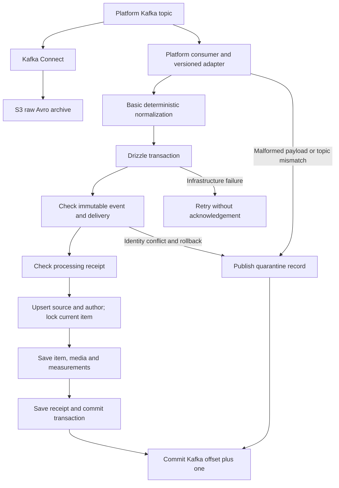

# Platform ingestion

Step 2 is implemented with a provisional payload adapter. Kafka Connect owns S3;
the worker writes only PostgreSQL. Final collector contracts and advanced enrichment
remain separate follow-up work.

## Flow

The two consumer paths are independent. PostgreSQL may be queryable before S3
rotation completes. There is no worker S3 SDK or duplicated upload. The worker
records transport coordinates and leaves archive URIs null. A future resolver can
fill exact Connect object locations without rewriting immutable event identities.

## Code boundaries

| Component | Responsibility |
| --- | --- |
| `packages/contracts/src/sources.ts` | Shared platform/topic/group/adapter registry used by worker, topic setup and Connect (`@nexus/contracts`). Kafka client lives in `@nexus/kafka`. |
| `apps/worker/src/adapters/` | Validates unknown provider payloads and maps them to the internal observation. Currently contains `provisional.v1`. |
| `packages/contracts/src/schema.ts` | Provisional envelope and supported basic fields; strict validation before DB persistence. |
| `packages/contracts/src/normalize.ts` | Stable item identity, UTC timestamps, Unicode normalization, hashtags and mentions. |
| `packages/database/src/ingestion/` | Typed Drizzle dimension/item/child writes. |
| `packages/database/src/ingest.ts` | Transaction boundary, event/delivery conflicts and receipts. |
| `apps/worker/src/heartbeat.ts` | Periodic heartbeat while processing; heartbeat failure prevents acknowledgement. |
| `apps/api/src/items/` | Authenticated item queries, reality scoping, filter-bound cursors and bigint serialization. |

Default topics are `raw.<platform>.v1`. One consumer and configurable group per
platform allow independent progress. The worker assigns reality 0 to real sources;
Kafka payloads never supply the ID. Every configured platform also has an always-on
`sim.<platform>.v1` consumer that assigns reality 1. The mapping is fixed: real
sources use 0 and simulation sources use 1, including custom subscriptions.
Migrations seed both records. Startup verifies
registration before consuming. A platform/topic mismatch or a payload containing
`realityId` is quarantined.
`KAFKA_SOURCES` supports custom platform/topic/group entries with a known adapter.
Adding a real provider format means implementing an adapter and selecting it in
that registry; no consumer-loop copy is needed.

## Basic data saved now

- Source identity/kind and supplied metadata; author identity and supplied profile measurements.
- Stable reality/platform/native item identity; Telegram native IDs are channel-qualified.
- Text/title, supplied URLs, source timestamps or explicit collection-time fallback.
- Supplied provider language in `lang_platform`; detected language stays unknown.
- Supplied or text-extracted hashtags/mentions, supplied links and provider extras.
- Supplied media metadata and provider-specific engagement snapshots.
- Supplied collection-query matches, only against registered queries of the same platform/reality.

No embeddings, inferred topics/entities/locations, OCR, translations, bot scores,
network fetches or automatic duplicate-root detection are generated. Location/NER
adapters can be added later against the existing tables. Unknown counts remain
NULL. Full-set media replacement is allowed only when the adapter declares a
complete snapshot; omitted metadata preserves known fields.

## Transaction guarantees

Event hashes cover the original parsed JSON before defaults or normalization.
The event ID is supplied by the collector and never generated on retry/replay.
Replay must keep the original topic-to-reality mapping: raw messages remain in
reality 0 and simulation messages remain in reality 1.
A reused event ID with another payload, or transport coordinate with another event,
is quarantined after rollback. Redelivery still records a distinct valid delivery
before skipping a completed processor receipt.

Source/author observations have timestamp guards. An advisory item lock serializes
new-item creation; row locks protect updates. Older or equal-time distinct events
cannot replace the selected current state. New text/title or changed media advances
content revision, invalidating old enrichment in the current view. Engagement
history is stored independently of whether the item observation won the current row.

There is one current content row, with historical raw observations in S3. This
release does not recreate the old relational document-version history.

Known validation/domain errors quarantine; arbitrary database failures propagate.
All consumers use manual offsets, heartbeat during persistence, and close before
the pool and quarantine producer on shutdown.

## Verification and deferred work

Embedded tests cover ingestion rollback, conflicts, partial profiles, late data,
media revisions, cross-reality reads and source identity. Real PostgreSQL tests
exercise duplicate concurrency, newest-observation races, simultaneous migration
runs and live catalog drift detection. An optional Kafka/Connect/LocalStack test
checks Telegram/X persistence, replay and byte-preserving archive output.

Remaining improvements: final provider adapters and sample contracts; archive URI
resolution; richer enrichment; deletion/retention workflows; workload benchmarks
and index tuning. The old public schema and old event format are retired by this
cutover. Deploy with the previous worker stopped.
