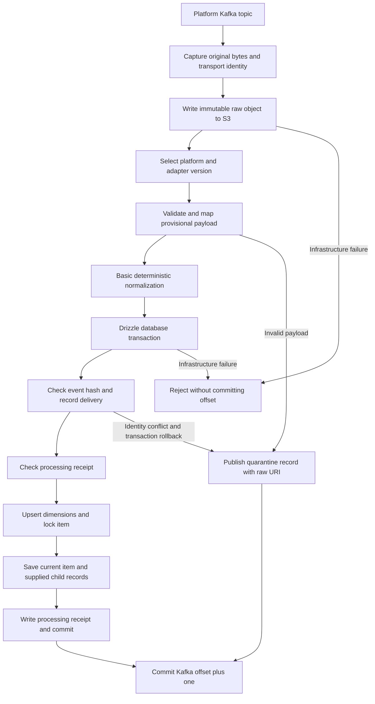

# Item ingestion next phase

Status: implementation plan for approval after the initial database phase.
The schema and Drizzle models exist; the consumer/API still use the legacy flow.
The incoming platform payload contracts are not finalized. Keep their adaptation
separate from the stable item model and transaction writer.

## Processing flow

S3 and PostgreSQL are not one atomic transaction. Write S3 first so a committed
item's `raw_uri` is usable. A database failure may leave a raw object with no item;
retries reconcile that object. Preserve the independent Kafka Connect archive so
raw retention does not depend on worker/database availability.

## Replaceable input adapters

Define the internal normalized item contract in `@nexus/contracts`, independent of
each provider's JSON. The Kafka boundary remains `unknown` until a versioned Zod
adapter parses it. Do not pretend the provisional format is an agreed collector
contract. Provide fixtures and an explicitly named provisional adapter for tests
and demo publishing; replace only that adapter when real sample messages arrive.

Each registered platform supplies a topic, consumer group, adapter name/version,
and normalizer. A central registry drives topic setup and consumer construction.
Adding a platform requires an entry and an adapter, without copying worker logic.
Keep registry configuration and the database platform seed consistent.

| Boundary | Proposed responsibility |
| --- | --- |
| `RawDelivery` | Stream incarnation, topic, partition, offset, timestamp, key, headers and original value bytes. |
| `SourceAdapter` | Parse `unknown`, validate provider-specific fields, and produce one normalized observation. |
| `NormalizedObservation` | Immutable event ID, platform, reality, collection time, source/author metadata, item fields and available child measurements. |
| `RawArchive` | Conditional S3 write, exact-byte checksum verification, original key/header preservation, and raw URI. |
| `ItemWriter` | One explicit Drizzle transaction with deduplication, locks and child persistence. |
| `ConsumerCoordinator` | Lifecycle, periodic heartbeats, quarantine routing, offset commitment, bounded concurrency and fatal failures. |

Initial target topics are `raw.<platform>.v1` for telegram, x, news, reddit, threads,
instagram, tiktok, youtube, bluesky and facebook. Use `sim.<platform>.v1` for
simulation input when enabled. Real topics accept reality 0 only; simulation
topics require a registered positive reality. Topic platform and payload platform
must agree. Consumer group names are platform-specific and configurable.
Keep current partition/replication defaults until throughput measurements justify
changes. Producers should key by stable reality/platform/native item identity.

Require a stable collector event ID. Do not manufacture a new random event ID in
the consumer. If a provider lacks one, the collector/provisional envelope must
define an observation identity before adoption. One raw message represents one
observation in this first version; batch payloads need a separately reviewed
deterministic split contract. Replaying an observation preserves its event ID;
creating a new simulated observation uses a new event ID.

## Basic enrichment now

| Populate now when possible | Leave for later |
| --- | --- |
| Platform, reality 0 default, provider and collector provenance | Language detection and confidence; keep provider language in `lang_platform`. |
| Stable item ID, channel-qualified Telegram native ID and normalized text hash | Embeddings, summaries, relevance, sentiment and topic classification. |
| Unicode/text normalization, whitespace cleanup and safe plain text from structured fields | Full HTML extraction; use a reviewed parser if actual payloads require it. |
| Canonical URL supplied by provider or safely constructed from known identifiers | Network URL expansion and article fetching. |
| Supplied title/body, timestamps in UTC and explicit collection-time publication fallback | Near-duplicate simhash and automated cross-item duplicate linking. |
| Supplied hashtags, mentions, links, media metadata and profile measurements | OCR, transcription, media downloads, bot scoring and inferred entities/locations. |
| Supplied engagement and explicit geographic tags with authoritative place IDs | Location inference, gazetteer matching and fabricated coordinates. |

Never use zero for an unknown count. Preserve `NULL` for absent enrichment.
Source registry values take precedence for arena/home country; unknown values
remain NULL. A provider's language claim does not become our detected language.
Regex extraction from plain text can be an explicit fallback for hashtags/mentions,
with deterministic Unicode behavior and fixtures; it must not claim completeness.

## Transaction and concurrency rules

1. Validate topic, reality and provider adapter; archive original bytes independently
   of normalization. Key the S3 object by stream/topic/partition/offset plus a raw
   checksum or otherwise reject overwrite conflicts. Verify existing objects on retry.
2. Open a Drizzle transaction. Insert immutable `ingest_events`; compare the original
   event hash on conflict. Hashing must not depend on current normalization or S3 path.
3. Insert transport delivery; a reused transport coordinate pointing at another event
   is a domain conflict. A duplicate receipt still records a new valid delivery.
4. Acquire dimension/item locks in a deterministic order. Check or insert receipt
   transactionally; any subsequent failure rolls it back. Do not perform S3/HTTP
   network work while database locks are held.
5. Upsert source/author metadata with observation-time guards. Treat missing fields
   as absent updates, with explicit adapter semantics for clearing/removal.
6. Upsert/lock the item by `(reality_id,platform,native_id)`. Older observations do
   not replace current state; equal times from distinct events keep first arrival.
   Preserve newer known edit timestamps. Advance last-seen time monotonically.
7. Update current-event provenance and content revision as appropriate. A controlled
   new processor version may re-normalize the same selected event. Deploy one active
   normalizer version per platform during this phase.
8. Save supplied media, engagement and query matches idempotently. Apply full-set
   replacement only when the adapter declares a complete snapshot. Validate taxonomy
   and query references; register configuration explicitly rather than inventing rows.
9. Finish the receipt and commit the transaction, then acknowledge Kafka. Maintain
   heartbeats throughout S3/database work and avoid concurrent processing within one
   partition. Infrastructure failures propagate without acknowledgement.

Handle malformed messages and known domain conflicts by publishing a durable
quarantine record, including the raw URI and transport provenance. Roll back any
failed transaction first. Quarantine publication failure also prevents acknowledgement.
Do not classify arbitrary SQL constraint violations as poison messages: application
bugs and infrastructure failures must remain visible and retryable.

## Code and API boundaries

Split worker coordination, platform registry, adapters, normalization, archive
storage and transaction writing into focused modules. NestJS owns resources and
shutdown; Drizzle reuses the shared pg pool. Add the S3 SDK only with dependency
approval. Keep ORM SQL expressions for PostGIS, row locks and conflict clauses
parameterized; ordinary persistence uses typed model operations.

After the worker phase is approved, update API repositories/controllers to
`/v1/items` and `/v1/items/:itemId`. Return database-style field names, explicit
reality filtering, decimal-string bigint values and keyset pagination. Include
filter identity in cursor validation and document live pagination behavior.
Update demo, replay, archive configuration and dashboard callers in the same
cutover. Retire the old public tables only after the new flow has passed review.

## Acceptance checks

- Telegram and X provisional messages persist the expected normalized item and raw bytes.
- Adding another registered platform does not require another copy of consumer code.
- Identical native IDs in different Telegram channels or realities remain distinct.
- Crash after S3 write, database commit, or before offset commit is retry-safe.
- Duplicate event IDs and reused transport offsets with different content quarantine.
- Late observations, partial profiles and equal-time provider measurements preserve data.
- Real/sim topic mismatches and cross-reality relationships are rejected.
- Stale enrichment cannot attach to a new content revision.
- Original event IDs survive archive replay.
- `npm run check` passes; real PostgreSQL concurrency and Kafka/S3 integration run separately.

Approve this phase before implementing the consumers and changing the event contract,
as requested in the step-by-step workflow.
